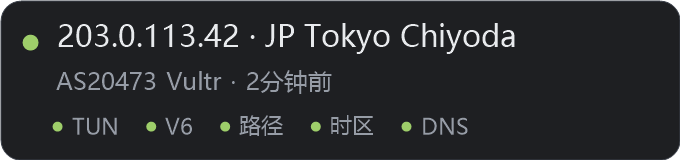
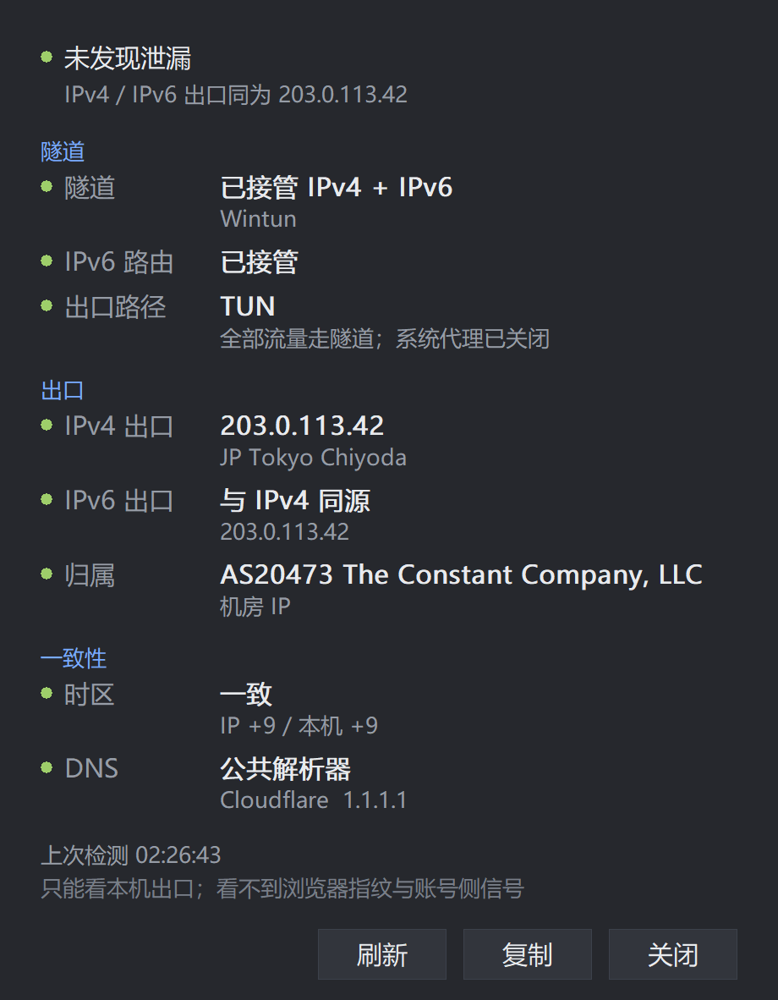
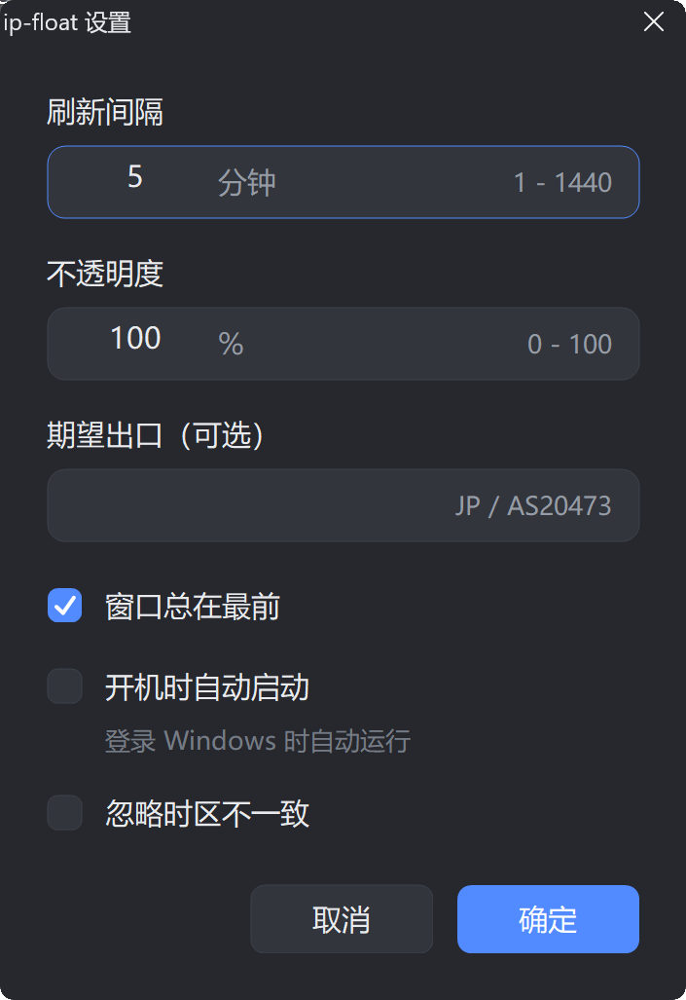

# ip-float — 出口 IP 桌面悬浮窗

[](https://github.com/jiqinghuang/ip-float/actions/workflows/build.yml)

无边框置顶小卡片，三行显示：出口 IP 与地区、ASN 与更新时间，以及五个状态徽章。

<p align="center">
  
</p>

<p align="center"><sub>卡片本体 · 340×80 逻辑像素 · 离屏渲染（示例数据）</sub></p>

第三行是五个状态徽章：**绿=正常、黄=存疑、红=问题、空心 ○=当前配置下不适用、实心灰 ●=没测到**。
灰点永远不冒充通过——没测过就是没测过。

卡片上只放结论。想知道**为什么**，右键打开诊断面板，每一行下面那行小字就是判定依据：

<p align="center">
   &nbsp;&nbsp;
  
</p>

<p align="center"><sub>左：右键「网络诊断…」，逐行给出依据 &nbsp;·&nbsp; 右：设置窗口</sub></p>

|路径|说明|
|-|-|
|**`ip-float.exe`**|★ 成品（当前 **v3.3.0**，约 963 KB）。单文件、双击即开、零运行时依赖。**不进 git**，分发走 [Releases](https://github.com/jiqinghuang/ip-float/releases/latest)|
|`src/`|C++ 源码（按职责拆分）+ 图标 + `build.ps1` / `sign.ps1`|
|`tests/`|纯逻辑单测（`build.ps1 -Test`）|
|`.site-assets/`|网站素材生成 / 站点页面校验|
|`preview-exe.png` / `preview-diag.png` / `preview-settings.png`|卡片、诊断面板、设置窗口的截图|

## 用法

直接双击 `ip-float.exe`。

* 纯 Win32 + GDI+，MinGW 静态编译，**不依赖 Python / .NET / Node / VCRedist**
* 只调 Windows 自带库：`gdiplus`、`winhttp`、`user32`、`gdi32`、`shell32`、`kernel32`
* 无控制台窗口、不占任务栏（只在托盘）、DPI 100%–200% 自适应（**包括拖到另一块不同缩放的屏幕**）
* 半透明圆角卡片，拖到哪记到哪
* **单实例**：已经有一个在跑时，再双击只会把已有卡片闪一下，不会开出第二张
* 点卡片**不抢焦点**（`WS_EX_NOACTIVATE`），你正在打的字不会被打断

**右键菜单**（卡片和托盘是同一套）：状态行（IP / 组织 / 数据源 / 更新时间） · 立即刷新 · 刷新间隔（1/3/5/10/30/60 分钟） · 设置… · 网络诊断… · 复制 IP · 总在最前 · 开机自启 · 退出。

**网络诊断窗口**：把第三行那五个徽章摊开，逐行给出**依据**（「IPv6 出口 2408:… 与 IPv4 出口 45.77… 不同源」），带刷新 / 复制 / 关闭；关掉后下次启动不会自动再打开，开着则记住。数据来自卡片同一轮抓取；v6 出口会额外发一两次短请求，DNS 解析器那次是本地查询。
**托盘图标**：双击显示/隐藏；右键菜单同上，额外多一项「隐藏卡片 / 显示卡片」。
**设置窗口**：刷新间隔（1–1440 分钟）、不透明度（0–100）、总在最前、开机自启（写 `HKCU\Software\Microsoft\Windows\CurrentVersion\Run`）。

> 不透明度拉到 **0** 卡片就完全透明了（还占着位置、点不到），这时从**托盘图标**右键 → 设置… 改回来。

### 配置位置

优先 `%APPDATA%\ip-float\settings.ini`；如果那目录不可写，自动退到 exe 同目录的 `ip-float.ini`
（若 APPDATA 里已有配置会先搬过去，不会默默丢设置；右键菜单最底下会显示当前实际生效的路径）。

要固定使用某份配置，用 **`--ini <path>`**：它优先于上面两者，自检和素材生成都走这个，
不会读也不会写你的真实配置。

> **受限环境会静默切到便携模式。** 在沙箱、低权限账户或被杀软拦截的 shell 里运行时，
> `%APPDATA%\ip-float` 可能写不进去，程序会退到 exe 同目录的 `ip-float.ini` ——
> 只有右键菜单最底下那行路径能看出来。最快的判据：**exe 旁边一旦出现 `ip-float.ini`，
> 就等于那一次启动没能写进 APPDATA**。
> 退化时**只有当 exe 目录还没有 ini，才会把 APPDATA 的配置搬过去**；如果那里已经有一份旧的，
> 程序会直接沿用旧值（间隔、不透明度、坐标都可能是很久以前的）。便携模式下改的设置
> **不会**回流到 APPDATA，下次正常双击仍然读 APPDATA。
> 它已在 `.gitignore` 里，反复生成也不会污染仓库；但别让这份副本长期停在旧值上 ——
> 删掉它，下一次退化启动会重新从 APPDATA 迁移一份过来。

删掉配置就恢复默认（右上角、5 分钟、94% 不透明）。`--ini` 指向的文件不存在时同样从默认值开始。

**期望出口（可选）**：在 ini 里写 `expectedCountry=JP`、`expectedAsn=AS20473`（ASN 也可以只写 `20473`）。
配置后诊断窗口会多一行「期望」，与当前出口不符时总判定至少是黄色；不配置则完全关闭这项检查。
目前通过 ini 配置，设置窗口暂不提供输入框。

### 命令行

```powershell
ip-float.exe --interval 10                       # 临时改间隔
ip-float.exe --source https://你的镜像/ip.json    # 换数据源（会写进 ini，下次继续生效）
ip-float.exe --ini D:\tmp\ip-float.ini           # 固定用某份配置
```

自检 / 素材生成：

```powershell
ip-float.exe --render out\card.png --render-scale 2   # 离屏渲染卡片（不联网、不建窗、不读写配置）
ip-float.exe --diag out\diag.txt                      # 出口体检报告（.txt + .json），不建窗口
ip-float.exe --render-dlg out\diag.png --render-scale 2  # 离屏渲染诊断面板（演示数据）
ip-float.exe --demo --shot out\card-screen.png        # 屏幕抓图 smoke test（演示数据）
ip-float.exe --demo --shot-dlg out\dlg.png            # 设置窗口抓图
```

* `--render` 直接画进 32bpp 位图，输出自带透明圆角，**不依赖桌面、壁纸、不透明度或屏幕 DPI**；
  同时写 `card.png.json`（width/height/scale/cornerRadius/colors）和 `card.png.log`。
  `--render-scale 2` 是 2x（680×160），默认也是 2。
* `--diag` 跑的是诊断窗口那套判定的同一个 `Diagnose()`：本机事实、v4/v6 出口、时区一致性、
  DNS 解析器。适合丢给 CI 或贴进 issue。**需要多久就等多久**（v4 出口 + v6 出口 + 解析器归属），
  失败项会在报告里写明原因，不会假装通过；v6 远端回显不可用时会另列「本机 IPv6」并标注它不是远端出口。
* `--shot` 走真实的卡片窗口，默认用演示数据（不联网）；只有同时给 `--source` 才取真实数据。
  `--shot-dlg` 只拍设置窗口，永远用演示数据、不联网。
* 这几种自检都**只读配置、不写回**（不会改你的位置/间隔/数据源）；也都不受单实例限制。
  一次只能拍一个。
* `--shot` 是屏幕抓图 smoke test，会受当前不透明度/桌面影响；给网页或文档用的干净素材
  请用 `--render`。`--shot-dlg` 拍的设置窗口本身不透明，不受不透明度影响。

## 源码结构

```
src/
  main.cpp          WinMain / 命令行 / DPI awareness
  app.cpp|app.h     App 状态、窗口过程、菜单、两阶段抓取编排
  config.cpp|.h     ini 路径、读写、开机自启注册表、期望出口
  http.cpp|.h       WinHTTP GET + 错误码翻译
  ipinfo.cpp|.h     纯解析：JSON -> IpInfo（不碰窗口）
  netinfo.cpp|.h    本机网络事实：代理、网卡/路由、IPv6、时区
  probe.cpp|.h      出口判定（纯逻辑，可脱离窗口单测）
  diag.cpp|.h       v4/v6/DNS 探测 + --diag 报告
  card.cpp|.h       CardMetrics / BuildCardText / GDI+ 绘制 / PNG
  detail_dlg.cpp|.h 网络诊断窗口
  settings_dlg.cpp|.h 设置窗口
  tray.cpp|.h       Shell_NotifyIcon + TaskbarCreated
  selftest.cpp|.h   演示数据 + --render / --render-dlg
  util.cpp|.h       UTF-8 / 时间 / DPI / URL
  version.h         版本号唯一来源（build.ps1 会检查三处一致）
  app.rc            ICON / manifest / VERSIONINFO
  app.manifest      asInvoker + PerMonitorV2 + longPathAware
tests/
  test_ipinfo.cpp   纯解析 / 卡片文案 / 时间 / URL 单测
  test_probe.cpp    诊断判定 / 徽章 / 期望出口单测
```

设计边界：纯逻辑（JSON、卡片文案、时间格式化、`Diagnose`）不碰窗口；I/O（HTTP、配置）不碰 UI；
`app.cpp` 只负责接线。这样 `ipinfo/util/probe` 可以脱离窗口直接单测，渲染也能离屏跑。

## 数据源

`https://ipinfo.io/json`，失败自动换 `https://ipapi.co/json/`；都不需要 key，
超时是 DNS / 连接 / 发送 / 接收各 8 秒。失败时保留上次结果、状态点变橙，并在卡片上写明原因：

* WinHTTP 错误码翻成了中文，例如 `12185：证书用途不匹配（常见于代理/中间人拦截）`、`12029：无法连接（端口不通、被墙，或该走代理）`
* HTTP 状态码也会给建议，例如 `429：请求太频繁，被数据源限流（调大间隔，或用 --source 换源）`、`403：被拒绝（数据源要 token，或你的出口 IP 被限流封禁）`

用 `--source` 换成自建源后，地址会写进 ini 的 `source=`，开机自启也会继续用它。
清空 `source=`（或 `--source ""`）即可回到内置双源。

## 重新编译

源码在 `src/`，默认需要 `D:\Mingw64\bin` 下的 `g++` 与 `windres`（可用 `-MingwBin` 改）：

```powershell
pwsh -File src\build.ps1                  # 只编译，输出到仓库根目录
pwsh -File src\build.ps1 -OutDir dist     # 输出到 dist\（不覆盖正在运行的旧 exe）
pwsh -File src\build.ps1 -Test -Werror    # 编译 + 单测；警告即错误
pwsh -File src\build.ps1 -Sign            # 编译 + 签名
```

* **默认不签名**：构建不应该有“创建根证书”这种副作用；签名是显式步骤。
* `-Test` 会编译并运行两套单测：`tests\test_ipinfo.cpp`（JSON 转义/代理对、ipinfo/ipapi 解析、
  `ShortAsn`、`Ago`、URL host）和 `tests\test_probe.cpp`（TUN/V6/路径/时区/DNS 判定、徽章、期望出口）。
* 版本号在 `src/version.h`（代码 / User-Agent）；`src/app.rc` 的 `VERSIONINFO` 和
  `src/app.manifest` 的 `assemblyIdentity` 里还有两份字面版本号。`build.ps1` 编译前会检查三处一致。
  exe 带 manifest（PerMonitorV2、asInvoker、longPathAware）。
* 构建开了 `-Wall -Wextra`，**应当零警告**；发布/CI 建议加 `-Werror`。
* 发版：改好三处版本号后打 tag 并 push（例如 `git tag v3.3.0 && git push origin v3.3.0`），
  GitHub Actions 会构建、跑两套单测并把 exe 上传到对应的 Release。

## 「打开文件 - 安全警告」/「Windows 已保护你的电脑」弹窗

双击 exe 要先点两次才能运行 —— 这是本机踩过的坑。**有两层互相独立的拦截，
必须分别处理**：只解决一层，另一层会立刻顶上来，表现为「弹窗换了个样子」。

### 第一层：SmartScreen「Windows 已保护你的电脑」

> Microsoft Defender SmartScreen 阻止了无法识别的应用启动。…发行者：发布者未知

按**文件哈希**做云端信誉判定。本机刚编译出来的 exe 微软服务器从没见过，
所以每次重编（哈希变了）都会拦。这一层**自签名挡不住**。

关掉它 ——「检查应用和文件」（需要管理员）：

```
[HKEY_LOCAL_MACHINE\SOFTWARE\Microsoft\Windows\CurrentVersion\Explorer]
"SmartScreenEnabled"="Off"
```

界面路径：Windows 安全中心 → 应用和浏览器控制 → 基于信誉的保护 →
关掉「检查应用和文件」。

* 想改回来：把值改成 `"Warn"`（系统默认），或直接删掉这个值。
* **别改错键**：`HKLM\SOFTWARE\Policies\Microsoft\Windows Defender\SmartScreen\EnableSmartScreen`
  是**另一套**东西（Defender / Edge 的 SmartScreen 策略），对这个弹窗没有作用。
* **这是整机级降级**：关掉后所有未知 exe 都不再被拦。只在自己清楚风险的开发机上这么做；
  给别人的分发包不要建议这一步。

### 第二层：附件管理器「打开文件 - 安全警告」

> 无法验证发布者。你确定要运行此软件吗? / 你想运行此文件吗?
> 发行商：未知发布者 … 此文件没有包含有效的数字签名以验证其发布者。

这是**附件管理器（Attachment Manager）**，跟 SmartScreen 是两套独立机制。
下面三步**缺一不可**：

**① 给 exe 签名**（`sign.ps1` 负责）

附件管理器**认本机信任的证书**。自签名证书放进 `CurrentUser\Root` 之后，
「发行商」就从「未知发布者」变成 `CN=ip-float self-signed`，红色警告随之消失。

> 注意这和 SmartScreen 恰好相反：**自签名对附件管理器有效，对 SmartScreen 无效。**

`sign.ps1` 新建证书时默认 **私钥不可导出（NonExportable）**、有效期 5 年。
已有的旧证书如果私钥可导出，脚本会提示；跑一次 `pwsh -File src\sign.ps1 -RecreateCert`
即可换成新证书（旧证书签名失效，重编后重新签名即可）。

**② 把 `.exe` 加进低风险包含列表**

```
[HKEY_CURRENT_USER\Software\Microsoft\Windows\CurrentVersion\Policies\Associations]
"LowRiskFileTypes"=".exe"
```

文档说明：这样 Windows 会忽略这些扩展名文件上的 ADS 标记 ——
"run them without warning ... regardless of whether the NTFS Zone.Identifier stream exists"。
（界面等价物：gpedit → 用户配置 → 管理模板 → Windows 组件 → 附件管理器 →
「低风险文件类型的包含列表」→ 填 `.exe`。）

> **这同样是整机级设置**：它让所有下载的 exe 都不再提示。只想解决一个文件时，
> 优先用 `Unblock-File <exe>`（针对单个文件的 MOTW）；要改回来就删掉
> `LowRiskFileTypes` 这个值（或把 `.exe` 从列表里去掉）。

**③ 重启资源管理器（这一步最关键，也最容易漏）**

`LowRiskFileTypes` 是**策略值，Explorer 只在启动时读一次**。
本机就是卡在这里：值写进去了，但 Explorer 从早上开机后一直没重启，
于是看起来“完全没效果”。

任务管理器（`Ctrl+Shift+Esc`）→ 找到「Windows 资源管理器」→ 右键 →「重新启动」。
之后再双击就正常了。

> 不要用「注销 / 重启电脑」以外的暴力手段去杀 Explorer —— 由受限进程拉起的新
> Explorer 可能继承限制，把桌面搞成打不开文件的状态。用任务管理器那个按钮最稳。

### 别再试了

| 方法 | 为什么没用 |
|---|---|
| 只清 MOTW（`Unblock-File`） | 如果 exe 来自 Releases，清掉 MOTW 只解决附件管理器这一层的一部分；SmartScreen 仍按哈希判定 |
| Defender 排除项（文件夹 / exe） | 跟 SmartScreen、附件管理器都是彼此独立的机制 |
| 改 `...\Defender\SmartScreen\EnableSmartScreen` | 改错键了，对这个弹窗无效 |
| 改完注册表不重启 Explorer | 策略值不会被读到，看起来像"无效" |
| 反复重编 exe | 每重编一次哈希就变一次，SmartScreen 那层的信誉归零 |

### 重编之后

`build.ps1` 默认只编译；加 `-Sign` 才会调用 `sign.ps1`。
证书已在 `CurrentUser\Root` 受信任的情况下，签名这一步**不需要管理员权限**。

## 网站素材

`.site-assets/` 是给个人网站 `project-ip-float.html` 生成截图素材的工具，跟 exe 本身无关：

```powershell
python .site-assets\generate.py
python .site-assets\validate.py --site-root ..\jiqinghuang.github.io
```

`generate.py` 用 exe 自带的自检模式：

* 卡片走 `--render`：离屏渲染，**不再依赖“先把不透明度设成 100”**，也不受桌面壁纸/DPI 影响；
  几何和配色从 sidecar `.json` 读，C++ 和 Python 不再各存一份半径/颜色常量。
* 设置窗口走 `--demo --shot-dlg`：仍然需要屏幕抓图来保留 Win11 的圆角和标题栏，
  所以裁边那一步假设**桌面是浅色**的；深色壁纸请先换一张浅色壁纸再跑。
* 两次都传 `--ini build\ip-float.ini`，配置完全隔离，不会读写 `%APPDATA%` 里的真实配置。

产物在 `.site-assets\out\`（card / diag / settings 各一张 png + webp），拷到站点仓库的 `assets/ip-float/`。
依赖 Pillow：`pip install pillow`。

## 已知限制

* **WinHTTP 处理 IPv6 字面量有缺陷**：带方括号时 `WinHttpConnect` 成功但 `SendRequest` 报
  `12029`，去掉方括号直接 `12005`。所以 v6 出口改用 AAAA-only 的 `ipv6.icanhazip.com`
  （域名不是字面量，`direct=true` 绕过系统代理）取真实地址；连这个也走不通时才退回
  TCP 连通测试。此时「IPv6 出口」写「未取到」，如果有本机公网 IPv6，会另起一行
  「本机 IPv6」并注明它不是远端出口。
* **DNS 那一项偶尔会显示「解析器返回了空应答（9501）」**：通常发生在刚切换 TUN 的瞬间
  （sing-box / Clash 的 DNS 后端还没就绪，回了空记录）。它已经带间隔重试三次，多数情况下自愈；
  如果持续出现，那是你本地解析器真的不给 `whoami.akamai.net` 这条记录，不是隧道的问题。
* 徽章的灰点分两种：**空心 ○ = 当前配置下不适用**（比如没开隧道时问「隧道接管了吗」），
  **实心灰 ● = 测了但没测到**。两者绝不能混为一谈，否则健康状态看起来像探测失败。
* 走 Windows **schannel**（WinHTTP）。如果网络里有中间人/企业代理导致证书校验失败，
  会看到 `12175/12182/12185` 之类的错误码 —— 这类环境需要换用 OpenSSL 栈的客户端。
* 每 N 分钟会向 ipinfo.io / ipapi.co 发一次请求，等于把出口 IP 报给第三方；介意就调大间隔或换自建源。
* exe 是**自签名**的：证书放在本机 `CurrentUser\Root`，**只对这个账户有效**。
  换机器 / 换用户后弹窗会回来 —— 用 `pwsh -File src\sign.ps1 -ExportCer` 导出 `.cer`，
  在那台机器上双击安装到「当前用户 → 受信任的根证书颁发机构」即可。
* 自签名证书的私钥默认不可导出；如果旧证书是可导出的，建议 `-RecreateCert` 重建。
* 双击弹窗的两层拦截与处理办法见上文专节；`build.ps1 -Sign` 编译后会自动重新签名。
* 设置窗口是模态的，拖到另一块不同 DPI 的屏幕上不会重新排版（卡片本身会）；
  窗口默认贴在卡片旁边打开，正常使用不会碰到。
* 仓库已接上 git（`origin` = `https://github.com/jiqinghuang/ip-float.git`）；
  改源码时顺手多提交几次，别攒成一个大 commit —— 出问题才有得回退。
* **`ip-float.exe` 不进仓库**：分发走 [GitHub Releases](https://github.com/jiqinghuang/ip-float/releases/latest)，
  下载链接固定为 `/releases/latest`。重编一次哈希就变一次，把约 963 KB 的二进制反复写进 git
  历史没有意义。`build.ps1` 默认输出到仓库根目录，但 `dist/` 和 `ip-float.exe` 都被忽略。
